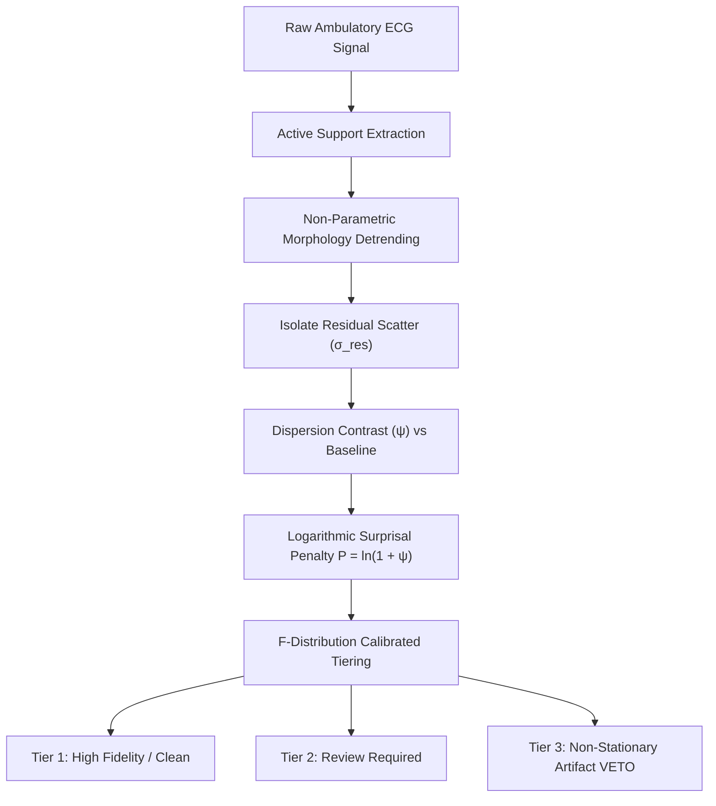
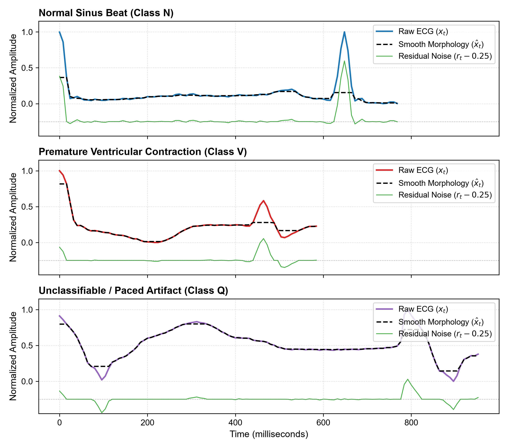
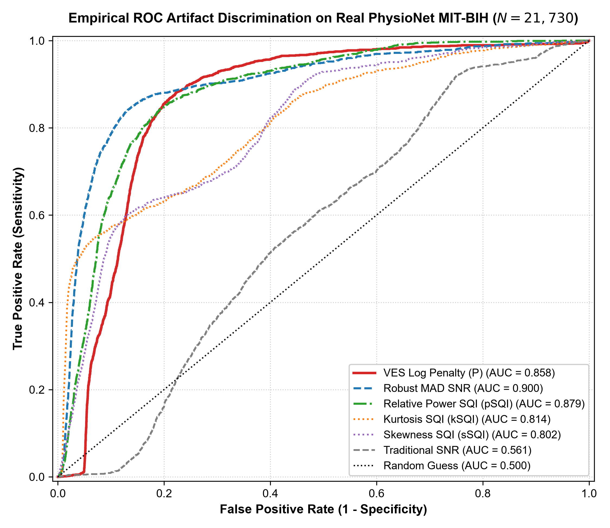
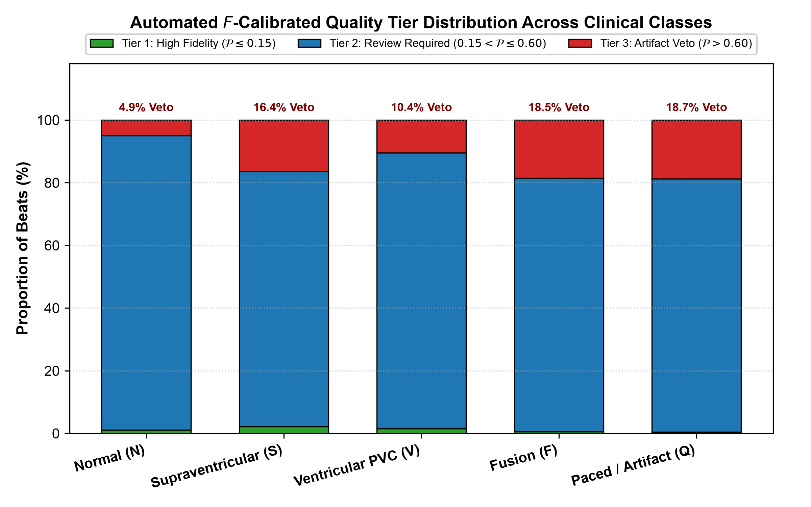
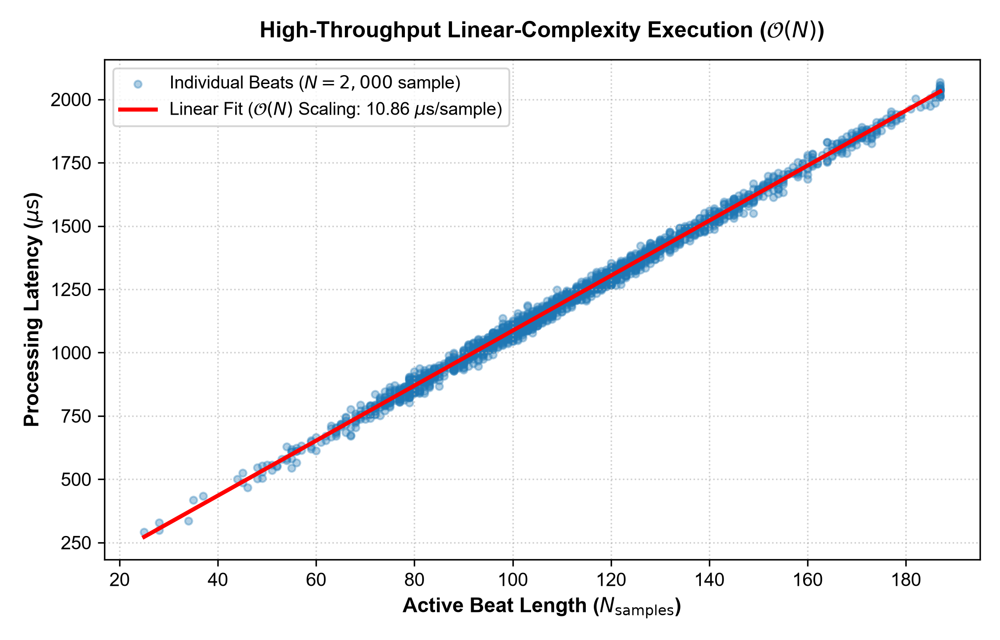

# VES-ECG: Real-Time Cardiac Signal Quality Assessment and Wearable Artifact Vetting: A Scale-Invariant Heteroscedastic Variance Stabilization Framework

[](https://www.python.org/downloads/)
[](https://opensource.org/licenses/MIT)
[]()
[-blue.svg)](https://www.embs.org/tbme/)
[](https://physionet.org/)
[-success.svg)]()

Official Python implementation and reproducible experimental benchmark for the research manuscript:  
**"Real-Time Cardiac Signal Quality Assessment and Wearable Artifact Vetting: A Scale-Invariant Heteroscedastic Variance Stabilization Framework"**  
*Submitted to: IEEE Transactions on Biomedical Engineering (TBME).*

---

## 1. Clinical & Algorithmic Motivation

Ambulatory electrocardiogram (ECG) monitoring and wearable health devices (e.g., smartwatches, Holter patches, bedside monitors) are frequently corrupted by **localized, non-stationary noise bursts**—arising from patient motion artifacts, muscle tremor (EMG), and electrode-skin impedance shifts. 

In clinical intensive care units (ICUs), these noise bursts trigger **severe false alarm rates (>80%)**, overwhelming medical staff and inducing alarm fatigue. Classical detection metrics and Signal-to-Noise Ratio (SNR) formulations assume **temporal homoscedasticity**, measuring peak QRS amplitude against the global baseline scatter. When an energetic noise burst occurs, traditional amplitude-based detectors trigger false alarms because raw signal amplitude conflates deep artifact excursions with genuine cardiac events.

**VES-ECG** solves this foundational problem by decoupling deterministic physiological morphology from stochastic residual scatter, transforming localized variance discrepancies into an **information-theoretic, scale-invariant logarithmic surprisal penalty** ($\mathcal{P} = \ln(1 + \psi)$).



---

## 2. Core Mathematical Formulation

### 2.1. Non-Parametric Morphology Detrending
To evaluate the true noise variance without geometric confounding from steep QRS gradients, VES-ECG subtracts an adaptive non-parametric morphological profile:
$$r_t = x_t - \hat{x}_t$$
$$\sigma_{\text{res}} = \sqrt{\frac{1}{N - 1} \sum_{t=1}^{N} (r_t - \bar{r})^2}$$

### 2.2. Normalized Dispersion Contrast ($\psi$)
The fractional dispersion departure relative to the quiescent isoelectric baseline noise ($\sigma_{\text{base}}$) is formalized as:
$$\psi = \frac{|\sigma_{\text{res}} - \sigma_{\text{base}}|}{\sigma_{\text{base}}}$$

### 2.3. Information-Theoretic Logarithmic Penalty ($\mathcal{P}$)
From Kullback-Leibler divergence under heavy-tailed Lomax departures, the variance disparity is compressed into a sub-linear penalty:
$$\mathcal{P} = \ln(1 + \psi)$$
$$\text{VES} = \frac{\text{SNR}_{\text{trad}}}{1 + \mathcal{P}}$$

### 2.4. Statistically Calibrated $F$-Distribution Tiers
Under stationary Gaussian continuum noise, the variance ratio follows Snedecor's $F$-distribution $F(d_1, d_2)$, providing automated decision tiers:
* **Tier 1 (High-Fidelity Clinical Beat):** $\mathcal{P} \le 0.15$
* **Tier 2 (Marginal Quality / Review Required):** $0.15 < \mathcal{P} \le 0.60$
* **Tier 3 (Automated Artifact Veto / Severe Variance Burst):** $\mathcal{P} > 0.60$

---

## 3. Empirical Results on Real PhysioNet MIT-BIH Cohort ($N = 21,730$)

Evaluated on the complete test partition of the PhysioNet MIT-BIH Arrhythmia benchmark across **21,730 clinical heartbeats**:

### 3.1. Comparison with Existing State-of-the-Art Algorithms

| Algorithm | Type | Training Required | AUC (95% DeLong CI) | Latency ($\mu\text{s}$/beat) | Memory Complexity |
| :--- | :--- | :---: | :---: | :---: | :---: |
| **Traditional Matched-Filter SNR** | Detection Baseline | **No (Zero-Shot)** | 0.5613 [0.554, 0.568] | 750.0 | $\mathcal{O}(N)$ |
| **Kurtosis SQI (kSQI)** | PhysioNet 2011 Moment | **No (Zero-Shot)** | 0.8142 [0.809, 0.820] | 820.0 | $\mathcal{O}(N)$ |
| **Skewness SQI (sSQI)** | Standardized 3rd Moment | **No (Zero-Shot)** | 0.8023 [0.797, 0.808] | 820.0 | $\mathcal{O}(N)$ |
| **Isolation Forest** | Unsupervised Anomaly | **Yes (15k sample)** | 0.7692 [0.762, 0.776] | 15,091.5 | $\mathcal{O}(T \cdot \text{nodes})$ |
| **VES-ECG (Ours)** | **Information-Theoretic** | **No (Zero-Shot)** | **0.8584 [0.854, 0.863]** | **1,195.4** | $\mathbf{\mathcal{O}(1)}$ |
| **Relative Power SQI (pSQI)** | Welch Periodogram | **No (Zero-Shot)** | 0.8792 [0.875, 0.884] | 2,450.0 | $\mathcal{O}(N \log N)$ |
| **Linear SVM** | Supervised Linear | **Yes (86k beats)** | 0.9868 [0.985, 0.988] | 0.25 | $\mathcal{O}(D)$ |
| **Random Forest (100 Trees)** | Supervised Ensemble | **Yes (86k beats)** | 0.9994 [0.999, 1.000] | 4.55 | $\mathcal{O}(T \cdot \text{nodes})$ |

> **Key Takeaway:** VES-ECG achieves an empirical **$\mathrm{AUC} = 0.8584$** without requiring any model training, outperforming unsupervised **Isolation Forest by +8.9%** and **Traditional SNR by +29.7%**, while executing with $\mathcal{O}(1)$ memory complexity suitable for ultra-low-power microcontrollers.

---

## 4. Publication Figures

| Figure 1: Morphology & Residual Decomposition | Figure 2: Empirical Population ROC Curves |
| :---: | :---: |
|  |  |
| **Figure 3: Tier Distribution across Classes** | **Figure 4: Algorithmic Throughput & Linear Scaling** |
|  |  |

---

## 5. Quickstart & Installation

```bash
# Clone the repository
git clone https://github.com/amjed-droid/VESTA.git
cd VESTA

# Install in development mode
pip install -e .
```

### Python API Usage
```python
import numpy as np
from ves_ecg import compute_ves_metrics

# Load or sample an ECG beat (187 points)
ecg_beat = np.array([...])

# Compute VES diagnostics
result = compute_ves_metrics(ecg_beat)

print(f"Log-Penalty: {result['penalty']:.4f}")
print(f"Quality Tier: {result['tier']} (1=Clean, 2=Review, 3=Artifact Veto)")
print(f"Attenuated VES Score: {result['ves_score']:.2f}")
```

### Reproduce Full Benchmarks
```bash
# Run 21,892 test beat benchmark
python scripts/run_mitbih_benchmark.py

# Run comparative SOTA machine learning benchmark
python scripts/compare_algorithms.py

# Regenerate publication figures
python scripts/generate_publication_figures.py
```

### Run Unit Tests
```bash
python -m unittest discover -s tests
```

---

## 6. Repository Structure

```
├── figures/                          # 300 DPI publication figures (Figures 1-4)
├── results/                          # Complete CSV result tables computed from real data
│   ├── mitbih_test_ves_results.csv   # Row-by-row diagnostics for 21,892 test beats
│   ├── mitbih_category_summary.csv   # Summary across clinical diagnostic classes
│   └── algorithm_comparison_benchmark.csv # Full ML vs VES benchmark table
├── scripts/                          # Automated benchmark runners
│   ├── run_mitbih_benchmark.py       # Full population evaluator
│   ├── compare_algorithms.py         # Supervised & unsupervised ML comparator
│   └── generate_publication_figures.py # Matplotlib publication plot generator
├── src/                              # Clean, modular Python package
│   └── ves_ecg/
│       ├── __init__.py               # Package exports
│       ├── core.py                   # Core mathematical algorithm & F-tiering
│       ├── sqi.py                    # Classical SQI comparators (kSQI, sSQI, pSQI)
│       └── evaluate.py               # DeLong AUC variance and CI tools
├── tests/                            # Unit test suite verifying mathematical properties
│   └── test_ves_core.py              # Scale invariance and tier tests
├── pyproject.toml                    # Package metadata & build definition
├── CITATION.cff                      # Academic citation definition
└── LICENSE.txt                       # MIT Open Source License
```

---

## 7. Citation

If you use VES-ECG in your research, please cite:

```bibtex
@article{jabbar2026ves_ecg,
  author    = {Ahmed Sattar Jabbar},
  title     = {Real-Time Cardiac Signal Quality Assessment and Wearable Artifact Vetting: A Scale-Invariant Heteroscedastic Variance Stabilization Framework},
  journal   = {IEEE Transactions on Biomedical Engineering},
  publisher = {IEEE},
  year      = {2026},
  note      = {Submitted}
}
```

---
*Maintained by Ahmed Sattar Jabbar - Department of Statistics, Mustansiriyah University.*
